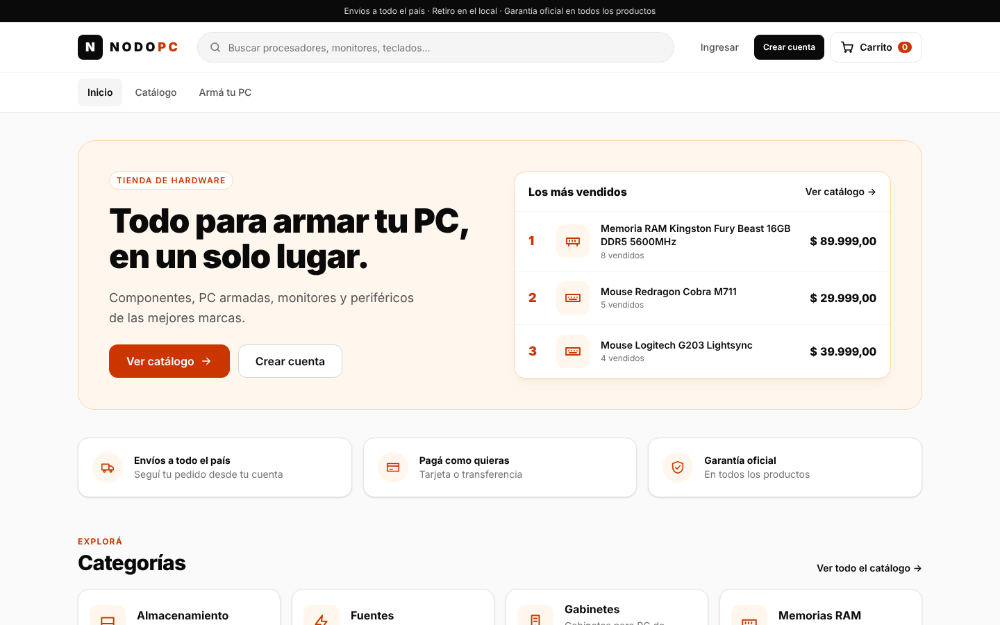
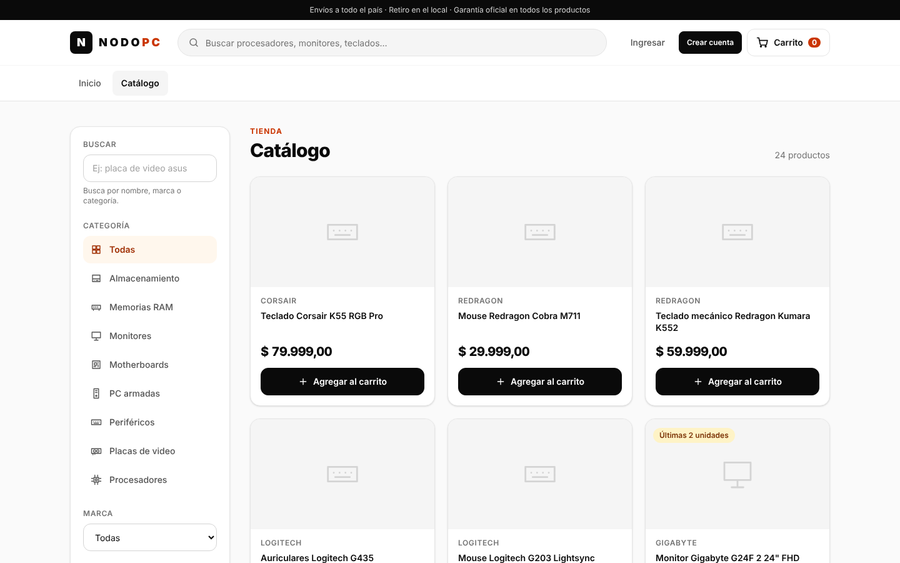
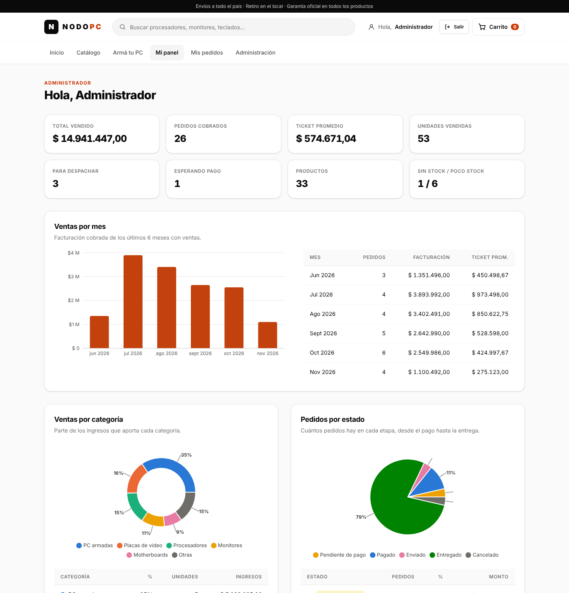
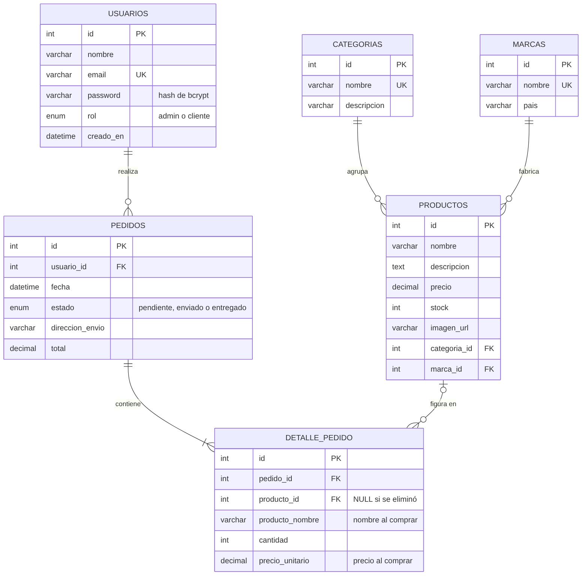

# NodoPC

Tienda online de hardware full stack, hecha con **React, Express y MySQL**.

[](https://github.com/Tutu-04/nodopc/actions/workflows/ci.yml)


NodoPC vende componentes de PC, PC armadas, monitores y periféricos. Los visitantes recorren el catálogo y arman un carrito, los clientes compran y siguen sus pedidos, y el administrador gestiona la tienda desde un panel con métricas de ventas.

> Proyecto de demostración: no se venden productos reales.

## Capturas

| Inicio                                                     | Catálogo                                             |
| ---------------------------------------------------------- | ---------------------------------------------------- |
|                         |   |
| **Detalle de producto**                                    | **Carrito**                                          |
|           |                 |
| **Gestión de productos**                                   | **Panel del administrador**                          |
|  |  |

## Funcionalidades

**Visitante**

- Portada con los productos más vendidos, las categorías y las últimas novedades.
- Catálogo paginado con búsqueda por palabras, filtros por categoría, marca, precio y stock, y orden por precio o nombre. Los filtros quedan en la URL, así se pueden compartir.
- Carrito que se guarda en el navegador y se actualiza con el precio y el stock reales.

**Cliente**

- Registro e inicio de sesión.
- **Armador de PC**: elige procesador, motherboard, memoria, placa de video, almacenamiento, fuente y gabinete, y avisa al instante si algo no es compatible (socket, tipo de memoria, tamaño del gabinete, potencia de la fuente). El armado se comparte con un enlace y se agrega entero al carrito.
- Ficha técnica en el detalle de cada componente.
- Checkout con envío a domicilio (costo por provincia, gratis desde $1.500.000) o retiro en el local.
- Pago con Mercado Pago (Checkout Pro en modo prueba) o con una tarjeta de prueba simulada.
- Seguimiento de cada pedido, desde el pago hasta la entrega, y cancelación mientras está pendiente.
- Página Mi cuenta para cambiar sus datos y su contraseña, y recuperación de la contraseña por correo.
- Correos de bienvenida, de pago acreditado y de cada cambio de su pedido.

**Administrador**

- Panel con métricas: ventas por mes, ventas por categoría, pedidos por estado, productos más vendidos, mejores clientes y productos con poco stock.
- Alta, edición y baja de productos, categorías, marcas y usuarios, con subida de imágenes y vista previa.
- Gestión de pedidos con filtro por estado: solo ofrece el paso siguiente del recorrido (pagado, enviado, entregado), y permite cancelar o eliminar cancelados.
- Las métricas cuentan solo lo cobrado.

## Tecnologías

| Parte         | Tecnologías                                                            |
| ------------- | ---------------------------------------------------------------------- |
| Frontend      | React 19, Vite, React Router, Zustand, Axios, Tailwind CSS 4, Recharts |
| Backend       | Node.js, Express 5, mysql2, bcrypt, jsonwebtoken                       |
| Base de datos | MySQL 8                                                                |
| Calidad       | Vitest, Supertest, Testing Library, ESLint, Prettier, GitHub Actions   |
| Entorno       | Docker Compose, nginx                                                  |

## Arquitectura

```
Navegador (React, puerto 5173)  ──HTTP + JSON──▶  API REST (Express, puerto 3000)  ──SQL──▶  MySQL (puerto 3306)
```

- El **frontend** nunca habla con la base: le pide todo a la API.
- El **backend** está en capas: las rutas definen las URL, los controladores validan y responden, y los modelos son los únicos que escriben SQL.
- Los **middlewares** verifican el token y el rol antes de llegar al controlador, y centralizan el manejo de errores.

## Cómo correrlo

### Con Docker (recomendado)

Solo hace falta [Docker Desktop](https://www.docker.com/products/docker-desktop/).

```bash
git clone https://github.com/Tutu-04/nodopc.git
cd nodopc
docker compose up --build
```

La primera vez tarda unos minutos. Cuando termina:

| Servicio | Dirección                                                           |
| -------- | ------------------------------------------------------------------- |
| Tienda   | <http://localhost:5173>                                             |
| API      | <http://localhost:3000/api>                                         |
| MySQL    | `localhost:3307`, usuario `nodopc`, contraseña `nodopc` (Workbench) |
| Correos  | <http://localhost:8025> (Mailpit: los correos que manda la tienda)  |

La base se crea con los datos de prueba la primera vez y se conserva entre reinicios.

| Comando                                          | Qué hace                                |
| ------------------------------------------------ | --------------------------------------- |
| `docker compose down`                            | Apaga todo y conserva los datos         |
| `docker compose down --volumes`                  | Apaga todo y borra la base              |
| `docker compose exec backend npm run crear-base` | Vuelve a los datos de prueba originales |

Los correos que manda la tienda (bienvenida, pagos, cambios de los pedidos y recuperación de contraseña) no salen a internet: quedan en Mailpit, en <http://localhost:8025>.

### Sin Docker

**Requisitos:** Node.js 22 o superior y MySQL 8.

```bash
git clone https://github.com/Tutu-04/nodopc.git
cd nodopc
npm run instalar
```

Copiá `backend/.env.example` como `backend/.env` y completá la contraseña de tu MySQL y una clave para `JWT_SECRET`. Después:

```bash
npm run crear-base    # crea la base con los datos de prueba
npm run backend       # terminal 1: API en http://localhost:3000
npm run frontend      # terminal 2: tienda en http://localhost:5173
```

Así el backend y el frontend se recargan solos al guardar cambios, que es la forma cómoda de desarrollar. La [guía de instalación](GUIA_DE_INSTALACION.md) explica cada paso en Windows desde cero, con la instalación de MySQL y la solución a los errores más comunes.

### Variables de entorno

Viven en `backend/.env` (con Docker, se pueden pasar al correr `docker compose up`). Las de pagos son opcionales.

| Variable                                       | Para qué sirve                                                                                     |
| ---------------------------------------------- | -------------------------------------------------------------------------------------------------- |
| `DB_HOST`, `DB_PORT`, `DB_USER`, `DB_PASSWORD` | Conexión a MySQL                                                                                   |
| `DB_NAME`                                      | Nombre de la base (`tienda_hardware`)                                                              |
| `JWT_SECRET`                                   | Clave para firmar las sesiones                                                                     |
| `FRONTEND_URL`                                 | Dirección de la tienda, para CORS y para volver desde Mercado Pago                                 |
| `COOKIE_SEGURA`                                | `true` para mandar la cookie solo por HTTPS                                                        |
| `MINUTOS_PARA_PAGAR`                           | Cuánto dura la reserva de stock de un pedido sin pagar (30 por defecto)                            |
| `PAGO_SIMULADO`                                | `false` para ocultar la tarjeta de prueba                                                          |
| `MP_ACCESS_TOKEN`                              | Access Token de Mercado Pago. Sin él, Mercado Pago no aparece como medio de pago                   |
| `MP_WEBHOOK_SECRET`                            | Clave secreta de los webhooks, para validar la firma de cada notificación                          |
| `API_PUBLICA_URL`                              | Dirección pública de la API (por ejemplo, un túnel), para que Mercado Pago pueda mandar los avisos |
| `SMTP_HOST`, `SMTP_PORT`                       | Servidor de correo. Sin `SMTP_HOST`, los correos se muestran en la terminal del backend            |
| `SMTP_USER`, `SMTP_PASS`                       | Usuario y contraseña del servidor de correo, si los pide                                           |
| `MAIL_FROM`                                    | Remitente de los correos                                                                           |

Los pasos para conseguir las credenciales de prueba de Mercado Pago están en la [guía de instalación](GUIA_DE_INSTALACION.md#pagos-con-mercado-pago).

### Usuarios de prueba

| Rol           | Email                | Contraseña   |
| ------------- | -------------------- | ------------ |
| Administrador | `admin@nodopc.com`   | `admin123`   |
| Cliente       | `cliente@nodopc.com` | `cliente123` |

Hay otros 5 clientes con pedidos de varios meses (`maria@`, `lucas@`, `sofia@`, `julian@` y `valentina@nodopc.com`, todos con `cliente123`), para que el panel de métricas tenga datos.

Para pagar sin configurar Mercado Pago, elegí **Tarjeta de prueba** en el checkout y apretá **Completar con la tarjeta de prueba**. Con `FUND` como titular, el pago se rechaza.

### Scripts

Todos se corren desde la carpeta principal.

| Comando              | Qué hace                                                         |
| -------------------- | ---------------------------------------------------------------- |
| `npm run instalar`   | Instala las dependencias de la raíz, del backend y del frontend  |
| `npm run crear-base` | Borra la base y la crea de nuevo con los datos de prueba         |
| `npm run migrar`     | Aplica solo las migraciones nuevas, sin tocar los datos          |
| `npm run backend`    | Arranca la API y la reinicia al guardar cambios                  |
| `npm run frontend`   | Arranca la tienda con Vite                                       |
| `npm test`           | Corre los tests del backend y del frontend                       |
| `npm run lint`       | Revisa el código con ESLint                                      |
| `npm run formatear`  | Ordena el código con Prettier (`npm run formato` solo lo revisa) |

## Tests

- **Backend:** Vitest y Supertest prueban la API de punta a punta contra MySQL: autenticación, permisos por rol, validaciones, stock, transacciones y métricas. Usan una base aparte, `tienda_hardware_test`, que se reinicia antes de cada archivo de tests y se crea sola la primera vez.
- **Frontend:** Vitest y Testing Library prueban el carrito, el formato de precios y componentes como las rutas protegidas.
- **Integración continua:** GitHub Actions corre el formato, el lint, todos los tests y el build en cada push.

## Estructura del proyecto

```
nodopc/
├── package.json               Scripts para manejar todo desde la raíz
├── docker-compose.yml         MySQL, backend y frontend con un comando
├── .github/workflows/         Integración continua
├── database/
│   ├── migraciones/           Cambios del esquema, en orden (001, 002...)
│   └── semillas/              Datos de prueba
├── docs/                      Diagrama de la base, capturas y documentación
├── backend/
│   ├── scripts/               migrar, preparar y crear-base
│   ├── uploads/               Imágenes subidas (no se suben a Git)
│   ├── tests/                 Tests de la API
│   └── src/
│       ├── app.js             Aplicación Express: middlewares y rutas
│       ├── index.js           Arranque del servidor
│       ├── config.js          Variables de entorno
│       ├── db.js              Conexión a MySQL
│       ├── migraciones.js     Aplica las migraciones y los datos de prueba
│       ├── routes/            Qué URL y qué método llama a cada función
│       ├── controllers/       Validan los datos y arman la respuesta
│       ├── models/            Consultas SQL
│       ├── middlewares/       Token, rol y manejo de errores
│       └── utils/             Validaciones y mensajes de error de MySQL
└── frontend/src/
    ├── App.jsx                Mapa de rutas
    ├── api/                   Cliente Axios que manda la cookie de sesión
    ├── store/                 Estado global con Zustand (sesión y carrito)
    ├── components/            Menú, rutas protegidas, gráficos y piezas reutilizables
    ├── pages/                 Una vista por archivo
    └── utils/                 Formato de precios y fechas, colores de los gráficos
```

## Base de datos



| Tabla                     | Guarda                                                                                 |
| ------------------------- | -------------------------------------------------------------------------------------- |
| `usuarios`                | Cuentas, con su rol y el hash de la contraseña                                         |
| `categorias`              | Tipos de producto, y qué componente de PC representa cada una                          |
| `marcas`                  | Fabricantes                                                                            |
| `productos`               | Lo que vende la tienda, con precio, stock y ficha técnica (JSON)                       |
| `pedidos`                 | Cada compra: estado, entrega, costo de envío, total, datos del pago y plazo para pagar |
| `detalle_pedido`          | Los productos de cada pedido, con el nombre y el precio del momento de la compra       |
| `recuperaciones_password` | Enlaces para restablecer la contraseña (solo el hash del token)                        |
| `migraciones`             | Qué archivos de `database/migraciones` ya se aplicaron                                 |

Los cambios de estructura viven en `database/migraciones` y se aplican solos al arrancar con Docker o con `npm run migrar`. Los datos de prueba no se tocan en una base que ya tiene datos: para tener los productos de las versiones nuevas (por ejemplo, las fuentes y los gabinetes del armador), corré `npm run crear-base`, que borra la base y la vuelve a crear.

## Decisiones técnicas

- **Consultas parametrizadas.** Todos los valores viajan como parámetros (`?`), nunca pegados al texto de la consulta. Así se evita la inyección SQL.
- **Contraseñas con bcrypt y sesión con JWT en una cookie `httpOnly`.** La base guarda solo el hash de cada contraseña. El token firmado dura 8 horas y viaja en una cookie que JavaScript no puede leer, así un script inyectado no puede robar la sesión.
- **Defensas del login.** Límite de intentos fallidos, contraseñas de al menos 8 caracteres con letras y números, y el mismo tiempo de respuesta exista o no el email.
- **Protección doble.** El frontend oculta y redirige las rutas privadas, y el backend vuelve a verificar el token y el rol en cada endpoint. Aunque alguien cambie su rol en el navegador, la API lo rechaza.
- **El precio lo pone el servidor.** Al comprar, el frontend manda solo el id y la cantidad de cada producto. El backend lee el precio y el stock de la base.
- **Pedidos con transacciones.** Crear un pedido toca tres tablas. Si algo falla en el medio, se deshace todo. Cada producto se bloquea con `SELECT ... FOR UPDATE`, así dos compras simultáneas no pueden vender la misma última unidad.
- **Reserva de stock con vencimiento.** Un pedido sin pagar reserva el stock durante 30 minutos; después se cancela solo y el stock vuelve al catálogo. El tiempo restante lo calcula MySQL, así no depende de la zona horaria de cada máquina.
- **Pagos que no se creen a ciegas.** Ni la vuelta de Mercado Pago ni su notificación marcan un pedido como pagado por sí solas: la API consulta el pago con su credencial y lo acredita solo si el monto y la moneda coinciden. Las notificaciones se validan con la firma HMAC de Mercado Pago, y acreditar el mismo pago dos veces no tiene efecto.
- **Correos que no frenan nada.** Se mandan sin esperar la respuesta del servidor de correo y un error al enviarlos queda en el log sin cortar la compra. Sin SMTP se muestran en la terminal; con Docker llegan a Mailpit. Todo dato del usuario se escapa antes de ponerlo en el HTML.
- **Recuperación de contraseña sin filtrar cuentas.** Responde igual exista o no el email, guarda solo el hash del token y cada enlace sirve una vez durante una hora.
- **Reglas del armador separadas de Express.** `armador/reglas.js` recibe componentes y devuelve problemas: no sabe de HTTP ni de MySQL, así que se testea con objetos simples. La API las usa para verificar un armado y para marcar, antes de elegirlas, las opciones que no encajan. El frontend no repite ninguna regla.
- **Fichas técnicas en JSON.** Cada componente guarda sus datos en una columna JSON, porque un procesador y un gabinete no comparten campos. La API valida la ficha según el tipo de componente, y el panel arma el formulario con la misma descripción de campos.
- **Integración sin SDK y testeable.** Mercado Pago se usa por su API REST con `fetch`. En los tests `fetch` se reemplaza, así la suite corre sin red ni cuenta.
- **Historial intacto.** `detalle_pedido` guarda el nombre y el precio de cada producto al momento de la compra, así los pedidos viejos no cambian si después se modifica o se elimina el producto.
- **Buscador sin consultas de más.** Busca cada palabra por separado en el nombre, la descripción, la marca y la categoría. Espera a que el usuario deje de escribir antes de consultar la API, y descarta las respuestas que llegan fuera de orden.
- **Métricas accesibles.** Cada gráfico de Recharts tiene al lado su tabla con los números exactos.
- **Imágenes validadas por su contenido.** Al subir una imagen, la API mira los primeros bytes del archivo para confirmar que es JPG, PNG o WebP, en lugar de confiar en la extensión. Al reemplazarla o eliminar el producto, se borra el archivo viejo.
- **Carga bajo demanda.** Las páginas de administración y los gráficos se descargan solo cuando se usan: el JavaScript inicial pesa menos de la mitad.
- **Interfaz sin librerías de componentes.** Los estilos que se repiten están definidos una sola vez en `index.css`, y los íconos son SVG propios. Si un producto no tiene foto, se muestra el ícono de su categoría.

## Documentación

- [API y rutas del frontend](docs/api.md): todos los endpoints, quién puede usarlos y las vistas de la aplicación.
- [Seguridad](docs/seguridad.md): cada protección, dónde está en el código y cómo comprobar que funciona.
- [Guía de instalación](GUIA_DE_INSTALACION.md): paso a paso en Windows.

## Hoja de ruta

- [x] Catálogo, carrito, pedidos, roles y panel con métricas
- [x] Migraciones, tests automáticos e integración continua con GitHub Actions
- [x] Levantar todo con un comando usando Docker Compose
- [x] Seguridad: helmet, límite de intentos, sesión en cookie `httpOnly` y rol verificado en la base
- [x] Catálogo paginado con orden y filtro por precio, Mi cuenta, menú para celulares y página 404
- [x] Subida de imágenes desde el panel del administrador
- [x] Envíos por provincia, pagos con Mercado Pago en modo prueba y pago simulado
- [x] Correos de bienvenida, pagos y estado de los pedidos, y recuperación de contraseña
- [x] Armador de PC con chequeo de compatibilidad
- [ ] Migración del frontend y el backend a TypeScript

## Autor

**Gonzalo Romeo Lazarte**, [@Tutu-04](https://github.com/Tutu-04)

## Licencia

[MIT](LICENSE)
