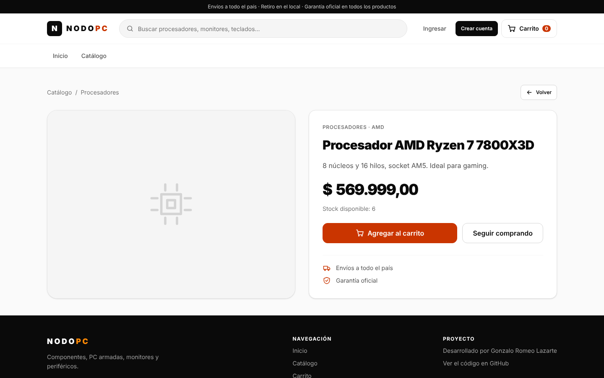
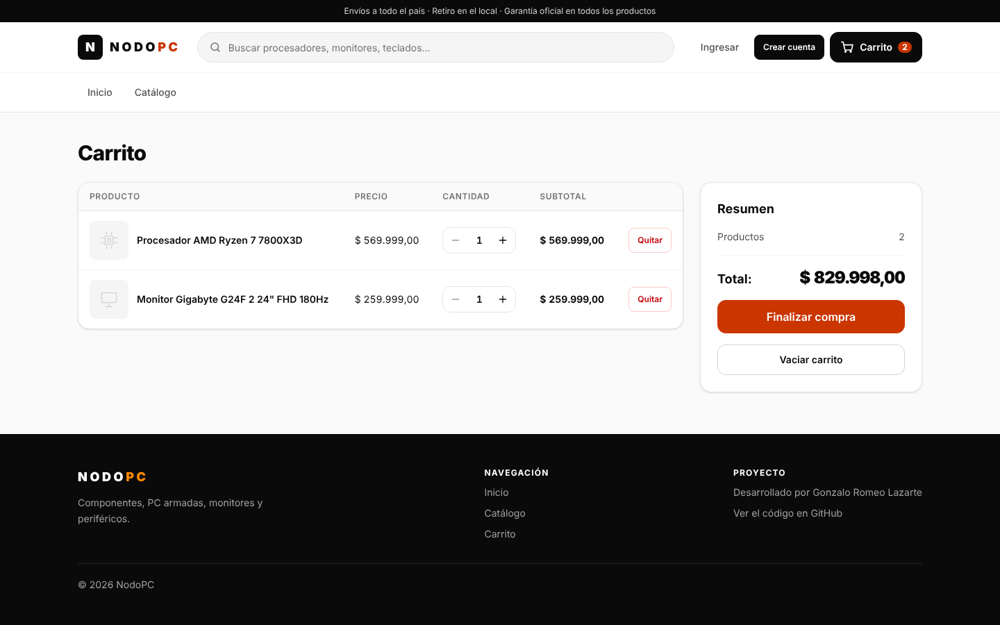
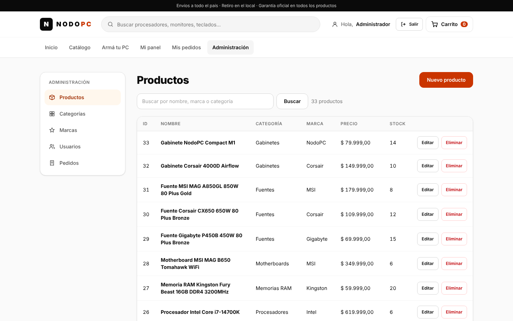

# NodoPC

Tienda online de hardware full stack, hecha con **React, Express y MySQL**.


NodoPC vende componentes de PC, PC armadas, monitores y periféricos. Los visitantes recorren el catálogo y arman un carrito, los clientes compran y siguen sus pedidos, y el administrador gestiona la tienda desde un panel con métricas de ventas.

> Proyecto de demostración: no se venden productos reales.

## Capturas

| Inicio                                                     | Catálogo                                             |
| ---------------------------------------------------------- | ---------------------------------------------------- |
|                         |   |
| **Detalle de producto**                                    | **Carrito**                                          |
|           |                 |
| **Gestión de productos**                                   | **Panel del administrador**                          |
|  |  |

## Funcionalidades

**Visitante**

- Portada con los productos más vendidos, las categorías y las últimas novedades.
- Catálogo con búsqueda por palabras y filtros por categoría, marca y stock.
- Carrito que se guarda en el navegador y se actualiza con el precio y el stock reales.

**Cliente**

- Registro e inicio de sesión.
- Compra con dirección de envío y seguimiento de sus pedidos.
- Cancelación de pedidos pendientes, que devuelve el stock.

**Administrador**

- Panel con métricas: ventas por mes, ventas por categoría, pedidos por estado, productos más vendidos, mejores clientes y productos con poco stock.
- Alta, edición y baja de productos, categorías, marcas y usuarios.
- Gestión de pedidos y de su estado (pendiente, enviado, entregado).

## Tecnologías

| Parte         | Tecnologías                                                            |
| ------------- | ---------------------------------------------------------------------- |
| Frontend      | React 19, Vite, React Router, Zustand, Axios, Tailwind CSS 4, Recharts |
| Backend       | Node.js, Express 5, mysql2, bcrypt, jsonwebtoken                       |
| Base de datos | MySQL 8                                                                |

## Arquitectura

```
Navegador (React, puerto 5173)  ──HTTP + JSON──▶  API REST (Express, puerto 3000)  ──SQL──▶  MySQL (puerto 3306)
```

- El **frontend** nunca habla con la base: le pide todo a la API.
- El **backend** está en capas: las rutas definen las URL, los controladores validan y responden, y los modelos son los únicos que escriben SQL.
- Los **middlewares** verifican el token y el rol antes de llegar al controlador, y centralizan el manejo de errores.

## Cómo correrlo

**Requisitos:** Node.js 22 o superior y MySQL 8.

```bash
git clone https://github.com/Tutu-04/nodopc.git
cd nodopc
npm run instalar
```

Copiá `backend/.env.example` como `backend/.env` y completá la contraseña de tu MySQL y una clave para `JWT_SECRET`. Después:

```bash
npm run crear-base    # crea la base con los datos de prueba
npm run backend       # terminal 1: API en http://localhost:3000
npm run frontend      # terminal 2: tienda en http://localhost:5173
```

La [guía de instalación](GUIA_DE_INSTALACION.md) explica cada paso en Windows desde cero, con la instalación de MySQL y la solución a los errores más comunes.

### Usuarios de prueba

| Rol           | Email                | Contraseña   |
| ------------- | -------------------- | ------------ |
| Administrador | `admin@nodopc.com`   | `admin123`   |
| Cliente       | `cliente@nodopc.com` | `cliente123` |

Hay otros 5 clientes con pedidos de varios meses (`maria@`, `lucas@`, `sofia@`, `julian@` y `valentina@nodopc.com`, todos con `cliente123`), para que el panel de métricas tenga datos.

## Estructura del proyecto

```
nodopc/
├── package.json             Atajos: instalar, crear-base, backend y frontend
├── database/
│   ├── migraciones/         Cambios del esquema, en orden (001, 002...)
│   └── semillas/            Datos de prueba
├── docs/                    Diagrama de la base, capturas y documentación
├── backend/src/
│   ├── index.js             Arranque de Express, middlewares y rutas
│   ├── db.js                Conexión a MySQL
│   ├── routes/              Qué URL y qué método llama a cada función
│   ├── controllers/         Validan los datos y arman la respuesta
│   ├── models/              Consultas SQL
│   ├── middlewares/         Token, rol y manejo de errores
│   └── utils/               Validaciones y mensajes de error de MySQL
└── frontend/src/
    ├── App.jsx              Mapa de rutas
    ├── api/                 Cliente Axios que agrega el token a cada pedido
    ├── store/               Estado global con Zustand (sesión y carrito)
    ├── components/          Menú, rutas protegidas, gráficos y piezas reutilizables
    ├── pages/               Una vista por archivo
    └── utils/               Formato de precios y fechas, colores de los gráficos
```

## Base de datos


| Tabla            | Guarda                                                                           |
| ---------------- | -------------------------------------------------------------------------------- |
| `usuarios`       | Cuentas, con su rol y el hash de la contraseña                                   |
| `categorias`     | Tipos de producto                                                                |
| `marcas`         | Fabricantes                                                                      |
| `productos`      | Lo que vende la tienda, con precio y stock                                       |
| `pedidos`        | Cada compra, con su estado y su total                                            |
| `detalle_pedido` | Los productos de cada pedido, con el nombre y el precio del momento de la compra |

## Decisiones técnicas

- **Consultas parametrizadas.** Todos los valores viajan como parámetros (`?`), nunca pegados al texto de la consulta. Así se evita la inyección SQL.
- **Contraseñas con bcrypt y sesión con JWT.** La base guarda solo el hash de cada contraseña. El login devuelve un token firmado que dura 8 horas y viaja en la cabecera `Authorization` de cada pedido.
- **Protección doble.** El frontend oculta y redirige las rutas privadas, y el backend vuelve a verificar el token y el rol en cada endpoint. Aunque alguien cambie su rol en el navegador, la API lo rechaza.
- **El precio lo pone el servidor.** Al comprar, el frontend manda solo el id y la cantidad de cada producto. El backend lee el precio y el stock de la base.
- **Pedidos con transacciones.** Crear un pedido toca tres tablas. Si algo falla en el medio, se deshace todo.
- **Historial intacto.** `detalle_pedido` guarda el nombre y el precio de cada producto al momento de la compra, así los pedidos viejos no cambian si después se modifica o se elimina el producto.
- **Buscador sin consultas de más.** Busca cada palabra por separado en el nombre, la descripción, la marca y la categoría. Espera a que el usuario deje de escribir antes de consultar la API, y descarta las respuestas que llegan fuera de orden.
- **Métricas accesibles.** Cada gráfico de Recharts tiene al lado su tabla con los números exactos.
- **Interfaz sin librerías de componentes.** Los estilos que se repiten están definidos una sola vez en `index.css`, y los íconos son SVG propios. Si un producto no tiene foto, se muestra el ícono de su categoría.

## Documentación

- [API y rutas del frontend](docs/api.md): todos los endpoints, quién puede usarlos y las vistas de la aplicación.
- [Seguridad](docs/seguridad.md): dónde están bcrypt y JWT en el código, y cómo comprobar que funcionan.
- [Guía de instalación](GUIA_DE_INSTALACION.md): paso a paso en Windows.

## Hoja de ruta

- [x] Catálogo, carrito, pedidos, roles y panel con métricas
- [ ] Levantar todo con un comando usando Docker Compose
- [ ] Seguridad: encabezados con helmet, límite de intentos de login y token en cookie `httpOnly`
- [ ] Pagos con Mercado Pago en modo prueba
- [ ] Emails de confirmación de pedido y de recuperación de contraseña
- [ ] Subida de imágenes desde el panel del administrador
- [ ] Paginación, orden y filtro por precio en el catálogo
- [ ] Tests automáticos e integración continua con GitHub Actions

## Autor

**Gonzalo Romeo Lazarte**, [@Tutu-04](https://github.com/Tutu-04)

## Licencia

[MIT](LICENSE)
